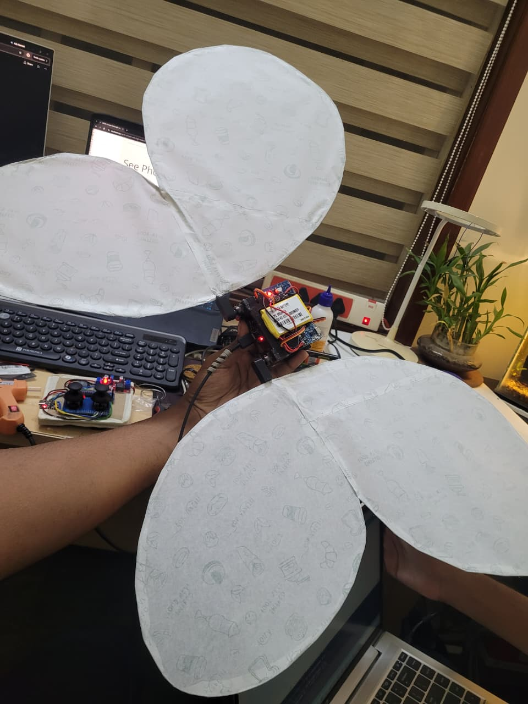
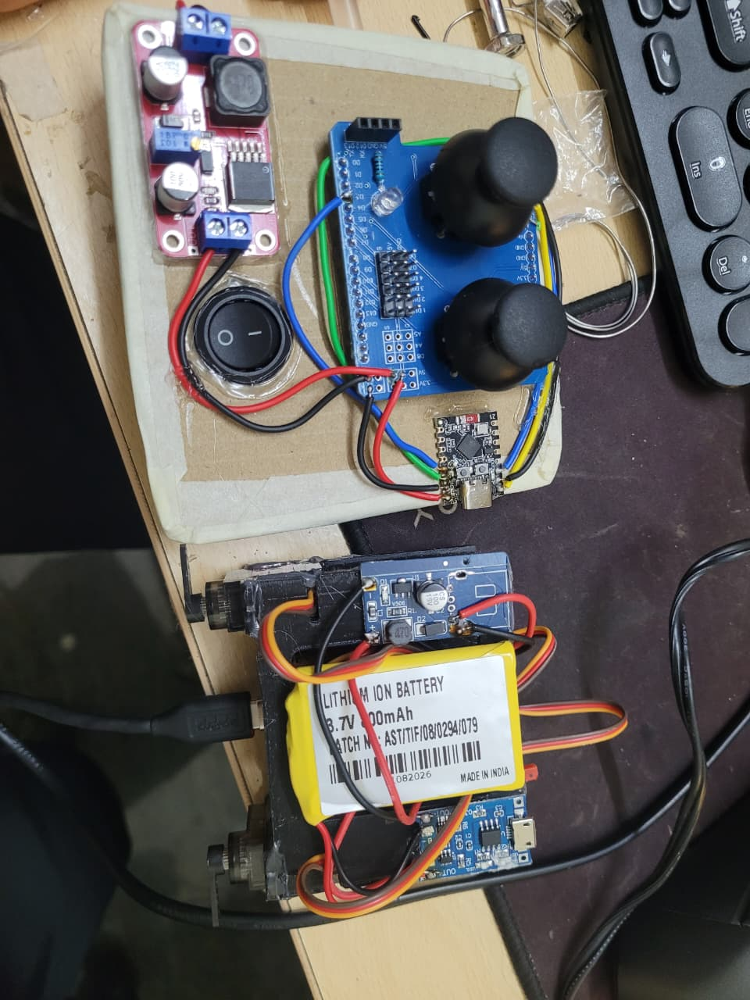
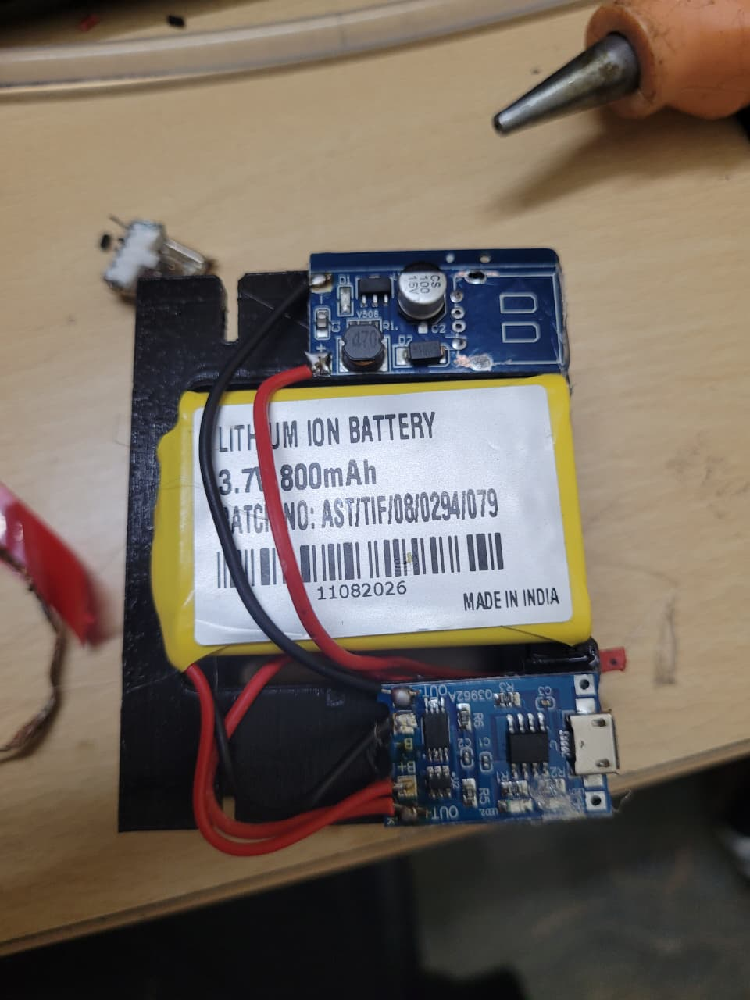
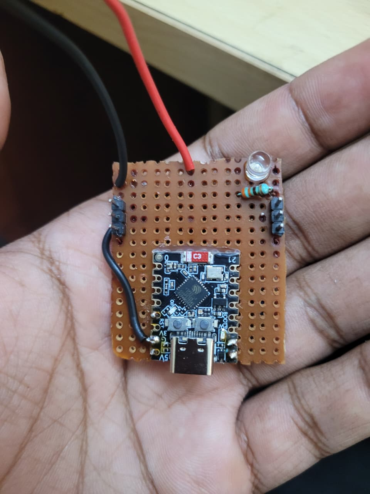
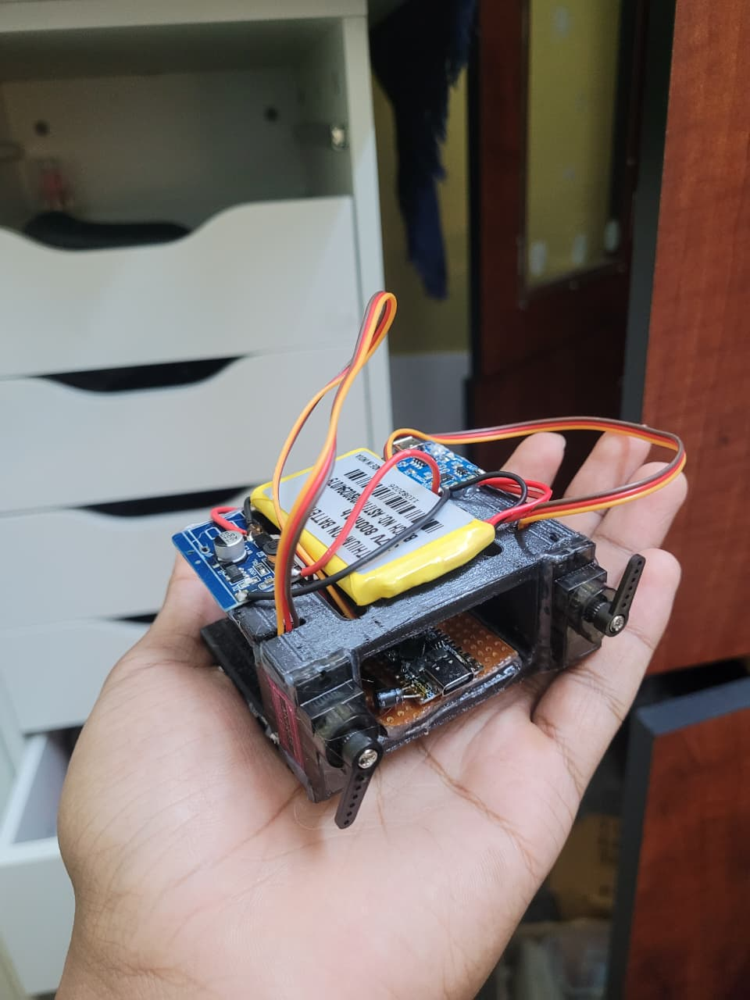
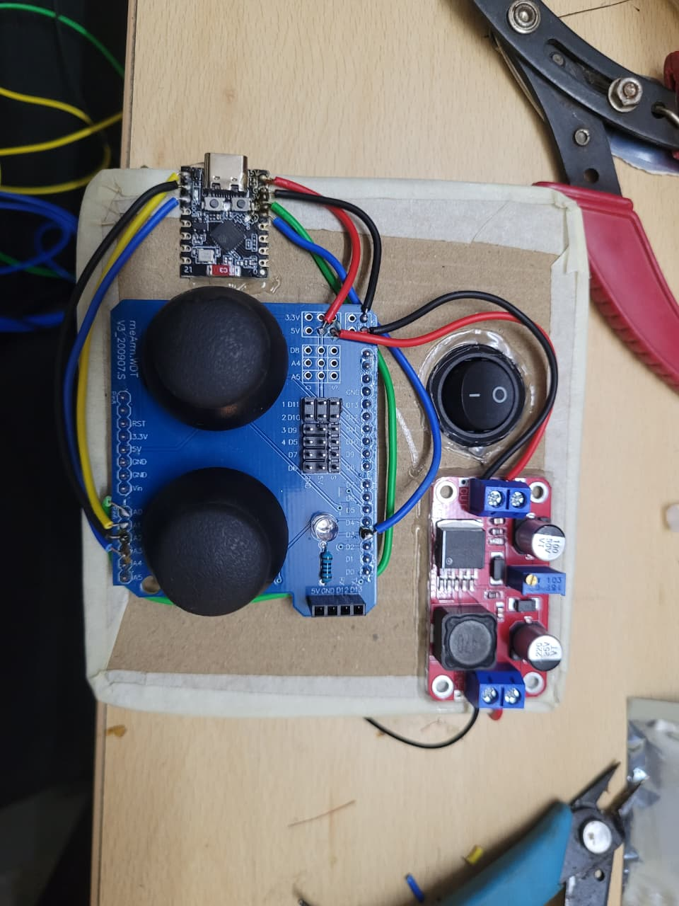

# Wireless Flapping Butterfly Robot

<p align="center">
  <strong>ESP32-C3 · ESP-NOW · Dual Joystick Control · Servo-Driven Wings</strong>
</p>

A wireless flapping-wing butterfly prototype built around two ESP32-C3 Mini boards. A dual-joystick transmitter sends control packets over ESP-NOW to a receiver that drives two MG90S servos. Flapping is enabled only while both joysticks are displaced from their calibrated center positions.

> **Project status:** Working prototype. Firmware, pin mappings, safety notes, build instructions, and prototype photos are included in this repository. Test the mechanism with the wing linkages disconnected before operating the assembled wings.

## Demo and Prototype

**Demo video:** `assets/media/demo.mp4`

Add the 9-second video at this path. The photos below document the controller, electronics, power assembly, servo mechanism, and prototype.

| Assembled prototype | Servo mechanism |
|---|---|
|  |  |

| Transmitter controller | Receiver electronics |
|---|---|
|  |  |

| Transmitter overview | Power module |
|---|---|
|  |  |

## Features

- Direct ESP-NOW communication; no Wi-Fi router is required.
- Two joystick inputs, each monitored on X and Y axes.
- Flapping starts only when both joysticks move beyond the calibrated dead zone.
- Joystick displacement controls flap amplitude and frequency.
- Two MG90S servos actuate the wings.
- Mirrored servo mounting is compensated using opposite electrical angle commands.
- Neutral command is 90°.
- Connection-status LEDs on transmitter and receiver.
- Receiver timeout fails safe to neutral when control packets stop arriving.
- Native SolidWorks part files and STL exports are organized under `design/`.

## Architecture

```text
Dual joystick shield
   │ 4 analog signals
   ▼
ESP32-C3 transmitter ─── ESP-NOW / channel 1 ───► ESP32-C3 receiver
   │                                                  │
   └── green status LED                               ├── left MG90S → left wing
                                                      ├── right MG90S → right wing
                                                      └── green status LED
```

The transmitter sends a `ControlPacket` containing joystick readings, a `bothMoved` flag, flap amplitude, and flap frequency. The receiver generates the continuous flap waveform locally, avoiding dependence on radio packet timing for each servo update. The receiver sends heartbeat packets back to the transmitter so the transmitter LED can reflect a two-way link.

## Hardware

| Component | Qty. | Role |
|---|---:|---|
| ESP32-C3 Mini / SuperMini | 2 | Transmitter and receiver |
| Dual joystick shield/module | 1 | User input |
| MG90S micro servo | 2 | Wing actuation |
| Green LED | 2 | Link-status indication |
| 220–330 Ω resistor | 2 | LED current limiting |
| Regulated 5 V servo supply | 1 | Independent servo power |
| Battery and suitable charging/protection module | As needed | Portable power |
| Perfboard, wires, switch and mounting hardware | As needed | Electronics assembly |
| Printed frame / servo mounts and wing material | As needed | Mechanical structure |

### Power and safety

- **Do not power MG90S servos from the ESP32-C3 3.3 V pin.** Use a regulated 5 V supply with adequate peak current.
- Connect the external servo supply ground to the receiver ESP32-C3 GND.
- Never apply 5 V directly to an ESP32-C3 GPIO or ADC input.
- Confirm battery polarity, regulator output, charging/protection ratings, and wiring before powering the assembly.
- Disconnect servo power before changing wiring or adjusting the servo horns.
- Initial tests should be performed with the wing linkages disconnected. Stop if a servo buzzes, stalls, heats up, or the linkage binds.

## Wiring and Pinouts

> **Important board note:** These pin assignments are for the firmware in this repository. ESP32-C3 board clones can have different labels/layouts. Match the printed GPIO number, not the physical pin position. The transmitter's joystick signals must use ADC-capable pins. GPIO 6 is not used for joystick ADC in this version; right Y uses GPIO 2.

### A. Transmitter — ESP32-C3 Mini

| Dual joystick signal | ESP32-C3 GPIO | Notes |
|---|---:|---|
| Left stick X / VRx | GPIO 4 | ADC input |
| Left stick Y / VRy | GPIO 1 | ADC input |
| Right stick X / VRx | GPIO 0 | ADC input |
| Right stick Y / VRy | GPIO 2 | ADC input |
| Green LED anode (+) | GPIO 3 through 220–330 Ω resistor | Active-high |
| Green LED cathode (−) | GND | Common ground |
| Joystick VCC | 3V3, if the module supports 3.3 V | Confirm module voltage compatibility |
| Joystick GND | GND | Shared ground |

**Transmitter wiring notes**

1. Connect each joystick analog output to its assigned ADC GPIO.
2. Supply the joystick module from 3.3 V only if it operates correctly at 3.3 V. The analog outputs must never exceed 3.3 V.
3. LED connection: `GPIO3 → 220–330 Ω resistor → LED anode (+)`; LED cathode (−) to GND.
4. Keep both joysticks centered during the two-second startup calibration.
5. The firmware uses all four analog axes to decide whether each stick has moved.

### B. Receiver — ESP32-C3 Mini

| Receiver component | ESP32-C3 connection | Notes |
|---|---|---|
| Left MG90S signal (orange/yellow) | GPIO 5 | PWM signal |
| Right MG90S signal (orange/yellow) | GPIO 6 | PWM signal |
| Green LED anode (+) | GPIO 3 through 220–330 Ω resistor | Active-high |
| Green LED cathode (−) | GND | Common ground |
| Both servo red wires | External regulated +5 V | Not ESP32 3V3 |
| Both servo brown/black wires | External supply GND | Join to ESP32 GND |
| External supply GND | ESP32-C3 GND | Common reference required |

**Receiver wiring notes**

- Servo wire colors are commonly orange/yellow = signal, red = +V, brown/black = GND; verify the specific servo's cable.
- The two servos share the external 5 V supply, but each signal wire goes to its own GPIO.
- The receiver firmware uses mirrored electrical angles: left angle is `90 + offset`, right angle is `90 - offset`. This is intended for the current mirrored mounting. If the physical mechanism moves incorrectly, power off and verify the horn/linkage orientation before changing software.
- The firmware initially commands 90° after attaching the servos. A servo may physically move to that commanded position at startup.

### C. Wiring summary

```text
TRANSMITTER
Joystick Left VRx ── GPIO4
Joystick Left VRy ── GPIO1
Joystick Right VRx ─ GPIO0
Joystick Right VRy ─ GPIO2
LED: GPIO3 ─ resistor ─ LED anode; LED cathode ─ GND
Joystick VCC ─ 3V3 (only if module supports it); GND ─ GND

RECEIVER
Left servo signal  ─ GPIO5
Right servo signal ─ GPIO6
LED: GPIO3 ─ resistor ─ LED anode; LED cathode ─ GND
Servo red wires ─ external regulated +5V
Servo brown/black wires ─ external GND
External GND ─ receiver ESP32-C3 GND
```

## Firmware

The complete sketches are included:

- [`firmware/transmitter/transmitter.ino`](firmware/transmitter/transmitter.ino)
- [`firmware/receiver/receiver.ino`](firmware/receiver/receiver.ino)

### Requirements

- Arduino IDE
- Espressif ESP32 board package (ESP32 Arduino core 3.x recommended)
- `ESP32Servo` library

### Upload steps

1. Open `firmware/receiver/receiver.ino` in Arduino IDE.
2. Select the correct ESP32-C3 board and COM port; compile and upload to the receiver.
3. Open `firmware/transmitter/transmitter.ino`.
4. Select the transmitter board and COM port; compile and upload.
5. Open Serial Monitor at **115200 baud** on each board.
6. Keep both joysticks centered while the transmitter samples their neutral positions at startup.
7. Check that each LED flashes briefly at boot, then both LEDs should remain on after valid control and heartbeat packets are exchanged.

The transmitter and receiver packet definitions, magic values, and channel must match. Do not mix sketches from older versions of the project.

## Control Logic

1. **Startup calibration:** the transmitter samples the center position of all four joystick axes. Keep both joysticks untouched during calibration.
2. **One joystick moved:** flapping remains off; the receiver holds both servos at neutral.
3. **Both joysticks moved:** flapping begins automatically.
4. **Amplitude:** scales from approximately ±20° to ±40° from neutral based on the smaller of the two stick deflections.
5. **Speed:** scales from approximately 0.8 to 2.5 cycles per second.
6. **Either joystick returns to center:** the next control packet disables flapping and commands neutral.
7. **Link lost:** after a 1-second control timeout, the receiver disables flapping and returns to neutral; the receiver status LED turns off. The transmitter LED turns off if no heartbeat is received within its timeout.

The values above are firmware defaults, not measured mechanical limits. Tune conservatively after testing the linkage.

## Mechanical CAD Files

Store design files in the following folders:

```text
design/
├── STL/          # Printable mesh exports (.stl)
└── SolidWorks/   # Native SolidWorks part files (.sldprt)
```

- STL files can be opened in a slicer to prepare prints.
- SLDPRT files preserve editable SolidWorks part geometry.
- Include any related assembly files (`.sldasm`), drawings (`.slddrw`), or print notes if available.

## Repository Layout

```text
butterfly-flapping-robot/
├── README.md
├── .gitignore
├── assets/
│   ├── photos/
│   ├── media/
│   │   └── demo.mp4
│   └── wiring/
├── docs/
├── firmware/
│   ├── transmitter/
│   │   └── transmitter.ino
│   └── receiver/
│       └── receiver.ino
└── design/
    ├── STL/
    └── SolidWorks/
```

## Test Procedure

1. Verify all power rails and common grounds with power disconnected.
2. Confirm joystick signals are within 0–3.3 V.
3. Power the ESP32 boards and verify the brief LED startup test.
4. Confirm the receiver reports that the transmitter peer is added and the transmitter begins receiving heartbeat packets.
5. Test servos with linkages disconnected; confirm neutral commands and no binding.
6. Move only one joystick and confirm flapping remains disabled.
7. Move both joysticks and confirm both servos move together physically.
8. Return either joystick to center and confirm the servos return to neutral.
9. Switch off the transmitter or move it out of range and confirm the receiver times out and returns to neutral.
10. Reconnect the wings and increase movement gradually, watching for binding or servo stall.

## Troubleshooting

| Symptom | Checks |
|---|---|
| `adc unit not supported` | Check the selected board/core and ensure all joystick inputs use ADC-capable GPIOs. This version uses GPIO 4, 1, 0, and 2. |
| ADC reads 0 or 4095 constantly | Check signal wiring, joystick supply, common ground, and whether the pin is floating or at a rail. |
| Startup LED does not flash | Verify LED polarity, resistor path, GPIO 3, and GND. |
| LED flashes at startup but stays off | Check ESP-NOW channel, matching packet structs/magic values, peer setup, and heartbeat packets. |
| Transmitter LED stays off but control packets arrive | Check receiver peer-add output and heartbeat send errors in receiver Serial Monitor. |
| Servo jitters or ESP32 resets | Use a suitable separate 5 V supply, common ground, short signal wires, and adequate current capacity. |
| Wings move opposite ways | Confirm the mirrored mounting and right-angle inversion; test with linkages disconnected. |
| Servo buzzes / stalls | Disconnect power, reduce the flap amplitude, and inspect mechanical alignment. |
| Flapping does not activate | Recalibrate with both sticks centered, then exceed the movement threshold on both sticks. |

## Known Limitations and Future Work

- Add an independent speed control if flap speed should be adjustable separately from the amount of joystick displacement.
- Add per-servo neutral calibration and configurable motion limits.
- Measure battery runtime and servo current under load.
- Validate wireless range and failsafe timing under repeatable conditions.
- Add strain relief and a more secure enclosure for the electronics.
- Record final bill of materials, print settings, and CAD revision details as the design matures.

## License

No license has been selected for this repository. Add a license only after deciding how you want others to reuse the firmware, documentation, photographs, and CAD files.
